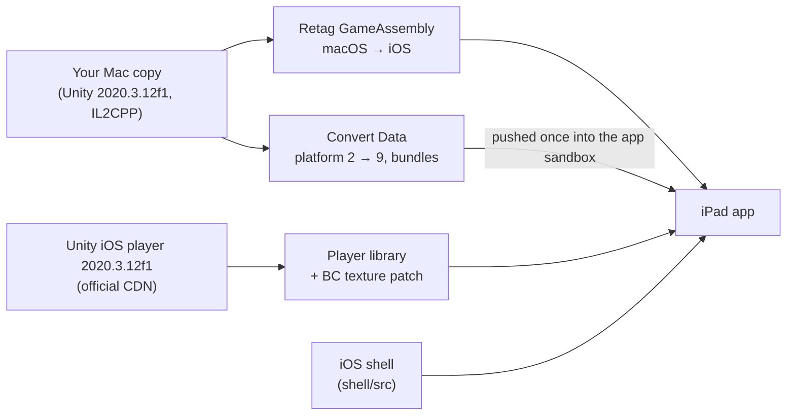

# Disco Elysium for iPad — a personal port toolchain

**Turns the Mac version of Disco Elysium – The Final Cut that you own into an app for your own iPad.** The game's own compiled code runs natively on the iPad; only the engine underneath is swapped for the iOS build of the very same Unity version. Hardware-decoded textures, full-screen layout, and touch controls designed around the game's mouse interface.

Platform: iPad with an M-series chip, iPadOS 27 (verified on iPad Pro 11-inch M5) · Game: the macOS release of The Final Cut, Unity 2020.3.12f1 · Build machine: Apple silicon Mac with Xcode · English / 中文 · License: MIT · **Bring your own game files**

中文: [README.zh-CN.md](README.zh-CN.md)

> This project provides only tools and an install shell that contains no game content. We do not distribute or endorse, and are not responsible for, any third party distributing game assets, game executables or install packages that contain game content. Please use only game files you legally own.

## What it is, and what it is not

**It is:**

- The game's own arm64 code (`GameAssembly`, compiled ahead of time by Unity's IL2CPP) **running unchanged on the iPad**. Only its Mach-O platform marker and system library paths are rewritten.
- The engine around it replaced by **Unity's own iOS player of the same version (2020.3.12f1)**, which each user downloads from Unity's official CDN.
- A thin iOS shell that fills the gaps between a Mac build and an iOS device: UIScene lifecycle, hardware BC textures, a Mac-shaped environment for the game code, full-screen layout, and a virtual mouse for touch.
- A toolchain you run on your own Mac: one health check, one setup command, one smoke test on the device.

**It is not:**

- An emulator, streaming, or a remake.
- **A source of game content.** There is no game program, data, art, text, audio or screenshot in this repository, and no Unity binary. Everything is produced on your machine from your files; see [docs/GAME_FILES.md](docs/GAME_FILES.md). The interoperability details the repository does carry (names of Unity bindings and game classes, short patch anchors) are listed in [docs/DERIVED.md](docs/DERIVED.md).
- A distribution channel. The app you build contains your game data; keep it to your own device.

## Status

Verified on an iPad Pro 11-inch (M5), iPadOS 27.2:

| | Result |
|---|---|
| Start-up | Engine initializes, all scenes load, the main menu appears in landscape |
| Rendering | Every texture uses the GPU's hardware BC decoding (previously 4,512 textures were decompressed on the CPU before the main menu) |
| Layout | Camera, UI, HUD and the start-up animation fill the 1.45:1 screen with no black bars and no distortion |
| Input | Tap, hover, drag, double-tap to run, right click, scroll; a highlight button for interactables |
| Game | New game, the opening dialogue, loading a save, and play in the first area were tested on the device |
| Memory | About 5.8 GB in game, with about 6.5 GB of headroom before the system would end the app |

## How it works



| Part | Where | What it does |
|---|---|---|
| Health check and setup | `setup.sh`, `Makefile` | Checks tools, game files and signing; runs every step below |
| Binary retagging | `scripts/prepare_binaries.sh` | Takes the arm64 slice of `GameAssembly` and the virtual-texture plugin, marks them as iOS, fixes system library paths |
| Stub libraries | `scripts/build_stubs.sh`, `tools/gen_stub.py` | Steam, GOG Galaxy, InControl and OpenGL replaced by "not available" stubs generated from the export names |
| Project generation | `scripts/gen_project.sh`, `tools/gen_registration.py`, `tools/patch_trampoline.py`, `tools/patch_player_lib.py` | Unity's iOS startup code with small patches, registration of every engine module and binding, and the hardware BC texture patch applied to Unity's player library at the LLVM IR level |
| Data conversion | `tools/convert_data.py`, `tools/unity_formats.py` | Changes the target platform in every serialized file and AssetBundle, lays the data out for the iOS player |
| iOS shell | `shell/src` | UIScene lifecycle, plugin redirection, Mac-shaped `platform` / `dataPath`, landscape, full-screen layout, virtual mouse and keys, highlight button, diagnostics |
| Device tools | `scripts/device.sh`, `scripts/smoke_test.sh` | Install, push data, stream logs, fetch logs and snapshots, automated smoke test |

The full engineering record — every problem met on the device, its cause and its fix — is in [docs/PORTING_NOTES.md](docs/PORTING_NOTES.md).

## Devices

| Device | Status |
|---|---|
| iPad Pro 11-inch (M5), iPadOS 27.2 | Verified |
| Other M-series iPads (M1 and later), iPadOS 17 or later | Expected to work (hardware BC textures); not verified |
| A-series iPads | Not verified. BC textures fall back to CPU decompression, which needs much more memory |
| iPhone | Not targeted (the app is built for iPad only) |

## Getting started

You need: an Apple silicon Mac with Xcode and XcodeGen, the Mac version of the game installed (Steam), a paid Apple developer account, and an M-series iPad paired with Xcode. Details: [docs/DEPENDENCIES.md](docs/DEPENDENCIES.md), [docs/GAME_FILES.md](docs/GAME_FILES.md).

1. Fill in your signing details:

   ```
   cp config.example.env config.env      # set TEAM_ID and BUNDLE_ID (your own); GAME_APP if the game is not in Steam's default folder
   ./setup.sh check                      # every line should be ✓; each ✗ says what to do next
   ```

2. Prepare everything (downloads Unity's iOS player once, about 530 MB; the first signed build registers your bundle ID):

   ```
   ./setup.sh
   ```

3. Install the app and the data on the iPad, then play:

   ```
   make install push-data
   make run          # or simply tap the app icon on the iPad
   ```

4. Check the result:

   ```
   make smoke
   ```

`make help` lists every target. Reinstalling or re-signing the app keeps the data on the iPad; run `make push-data` again only after the data changes. `make logs` fetches `Player.log` from the iPad.

## Controls

| Gesture | Mouse equivalent |
|---|---|
| Tap | Left click (tap twice quickly = double click, which makes the character run) |
| Long press, then slide | Move the pointer only (hover to read names and descriptions); nothing is clicked when you lift |
| Clear drag | Left-button drag |
| Two-finger tap | Right click |
| Two-finger swipe | Scroll wheel |
| Magic Keyboard trackpad / Apple Pencil hover | Moves the pointer; trackpad secondary click is a right click |

The single button on the left is **highlight** (the game's Tab key): tap it to keep interactables highlighted until your next tap in the game; hold it to highlight only while held. Everything else is in the game's own interface.

## Reproducing with an AI coding agent

The repository is written so that an agent can reproduce the port on another person's Mac and iPad. [AGENTS.md](AGENTS.md) is the runbook (with a gate for every step); [docs/VERIFY.md](docs/VERIFY.md) lists the expected output of every command and what each smoke-test failure points to; [docs/PORTING_NOTES.md](docs/PORTING_NOTES.md) explains every fix, and how to adapt them to another build.

## Known limitations

| Item | Status |
|---|---|
| Steam achievements, cloud saves | Not available; Steam is stubbed. Saves stay on the iPad |
| Game controllers | Not supported yet (InControl's native layer is stubbed) |
| Other builds of the game, other Unity versions | Not verified; several steps are tied to the exact Unity version and game classes, see [docs/PORTING_NOTES.md](docs/PORTING_NOTES.md) section 9 |
| GOG Mac release | Not verified (it may be the same build) |
| Free Apple developer accounts | Not verified; the memory entitlements may not be available |
| A-series iPads | Not verified; textures would be decompressed on the CPU |

## Documentation by part

| Document | Covers |
|---|---|
| [AGENTS.md](AGENTS.md) | Runbook for AI coding agents |
| [docs/PORTING_NOTES.md](docs/PORTING_NOTES.md) | How it works; every problem met, its cause and fix; diagnostics; adapting to other builds |
| [docs/VERIFY.md](docs/VERIFY.md) | Checks at every level, the smoke test, expected results, the manual checklist |
| [docs/GAME_FILES.md](docs/GAME_FILES.md) | Which copy of the game, what is used, where the data goes on the iPad |
| [docs/DEPENDENCIES.md](docs/DEPENDENCIES.md) | Tools, versions, the Unity package and its checksum |
| [docs/DERIVED.md](docs/DERIVED.md) | Game- and Unity-related material in the repository: what is here, what is not, and why |
| [CONTRIBUTING.md](CONTRIBUTING.md) | Checks before a change, the three rules, submitting and reporting |

## Legal

**You must own the game.** This is an independent, non-commercial project for personal use. It is not affiliated with, endorsed by, or sponsored by ZA/UM, Unity Technologies, Valve or Apple. Disco Elysium is a trademark of its respective owner; Unity is a trademark of Unity Technologies; Steam is a trademark of Valve Corporation. The Unity iOS player is downloaded by each user from Unity and used under Unity's terms; it is not part of this repository.

## Acknowledgements

- **Unity Technologies**: the iOS player of Unity 2020.3.12f1, downloaded by each user from Unity's CDN.
- **XcodeGen** (yonaskolb): generating the Xcode project.
- **d2r-mobile** (jhaizhou-ops): the repository layout and documentation conventions of this project follow that project's example.

## License

MIT, see [LICENSE](LICENSE).
