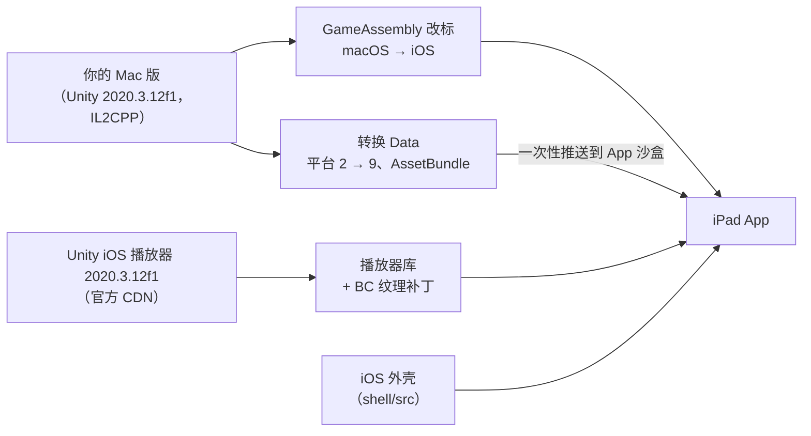

# 极乐迪斯科 iPad 版——个人移植工具链

**把你拥有的《极乐迪斯科：最终剪辑版》Mac 版，变成能在你自己 iPad 上运行的 App。** 游戏自己编译好的代码在 iPad 上原生运行，只把底下的引擎换成同一个 Unity 版本的 iOS 构建。纹理由 GPU 硬件解码，画面铺满全屏，触屏操作围绕游戏原本的鼠标交互重新设计。

平台：M 系列芯片的 iPad，iPadOS 27（已在 iPad Pro 11 英寸 M5 上验证）· 游戏：最终剪辑版的 macOS 版，Unity 2020.3.12f1 · 构建机：装有 Xcode 的 Apple 芯片 Mac · English / 中文 · 许可证：MIT · **自带游戏文件**

English: [README.md](README.md)

> This project provides only tools and an install shell that contains no game content. We do not distribute or endorse, and are not responsible for, any third party distributing game assets, game executables or install packages that contain game content. Please use only game files you legally own.
>
> 本项目只提供工具和一个不含任何游戏内容的安装外壳。我们不分发、不认可、也不对任何第三方分发游戏资源、游戏可执行文件或含游戏内容的安装包负责。请只使用你合法拥有的游戏文件。

**新增、实验性、默认关闭：Steam 成就。**你在 iPad 上玩，由你 Mac 上的 Steam 客户端提交成就，通过本地网络实时送达，或者之后补发。见 [docs/ACHIEVEMENTS.zh-CN.md](docs/ACHIEVEMENTS.zh-CN.md)；不开启时，移植版和原来完全一样。

## 它是什么，不是什么

**它是：**

- 游戏自己的 arm64 代码（`GameAssembly`，由 Unity 的 IL2CPP 预先编译）**在 iPad 上原样运行**。只改写了 Mach-O 的平台标记和系统库路径。
- 外围的引擎换成 **Unity 自己的同版本（2020.3.12f1）iOS 播放器**，由每个用户自己从 Unity 官方 CDN 下载。
- 一层很薄的 iOS 外壳，补上 Mac 构建和 iOS 设备之间的差距：UIScene 生命周期、硬件 BC 纹理、给游戏代码的"Mac 环境"、铺满屏幕的布局、触屏用的虚拟鼠标。
- 一套在你自己 Mac 上运行的工具链：一次体检、一条准备命令、一次设备上的冒烟测试。

**它不是：**

- 模拟器、串流，或者重制版。
- **游戏内容的来源。**仓库里没有任何游戏程序、数据、美术、文字、音频或截图，也没有任何 Unity 二进制。一切都在你的电脑上由你的文件生成，见 [docs/GAME_FILES.zh-CN.md](docs/GAME_FILES.zh-CN.md)。仓库里确实带有的对接信息（Unity 绑定和游戏类的名称、简短的补丁锚点）逐项列在 [docs/DERIVED.zh-CN.md](docs/DERIVED.zh-CN.md)。
- 分发渠道。你构建出的 App 含有你自己的游戏数据，只装在你自己的设备上。

## 现状

在 iPad Pro 11 英寸（M5）、iPadOS 27.2 上验证：

| | 结果 |
|---|---|
| 启动 | 引擎初始化、全部场景加载，横屏显示主菜单 |
| 渲染 | 所有纹理都由 GPU 硬件 BC 解码（修复前，进主菜单前就有 4512 张纹理在 CPU 上解压） |
| 布局 | 相机、UI、HUD 和启动动画都铺满 1.45:1 的屏幕，没有黑边，没有变形 |
| 输入 | 轻点、悬停、拖动、双击跑步、右键、滚轮；一个用于高亮可交互物的按钮 |
| 游戏 | 新游戏、开场对话、读取存档、在第一个区域里游玩，都已在设备上测试 |
| 内存 | 游戏中约 5.8 GB，距系统强制结束还有约 6.5 GB 余量 |
| Steam 成就 | 可选：在 iPad 上记录，通过你 Mac 上的 Steam 客户端提交（[docs/ACHIEVEMENTS.zh-CN.md](docs/ACHIEVEMENTS.zh-CN.md)）。实验性，默认关闭。已在参考环境的 iPad 上用游戏里真正拿到的成就验证（几秒后出现在 Steam 个人资料上） |

## 原理



| 部分 | 位置 | 作用 |
|---|---|---|
| 体检与准备 | `setup.sh`、`Makefile` | 检查工具、游戏文件和签名配置，并依次执行下面各步 |
| 二进制改标 | `scripts/prepare_binaries.sh` | 取 `GameAssembly` 和虚拟纹理插件的 arm64 部分，标记为 iOS，修正系统库路径 |
| 桩库 | `scripts/build_stubs.sh`、`tools/gen_stub.py` | 用按导出函数名生成的"不可用"桩库代替 Steam、GOG Galaxy、InControl 和 OpenGL |
| 生成工程 | `scripts/gen_project.sh`、`tools/gen_registration.py`、`tools/patch_trampoline.py`、`tools/patch_player_lib.py` | 带少量补丁的 Unity iOS 启动代码、注册全部引擎模块和绑定，以及在 LLVM IR 层面给 Unity 播放器库打的硬件 BC 纹理补丁 |
| 数据转换 | `tools/convert_data.py`、`tools/unity_formats.py` | 修改每个序列化文件和 AssetBundle 的目标平台，按 iOS 播放器的要求排布数据 |
| iOS 外壳 | `shell/src` | UIScene 生命周期、插件重定向、Mac 式的 `platform` / `dataPath`、横屏、铺满屏幕、虚拟鼠标和按键、高亮按钮、诊断工具 |
| 设备工具 | `scripts/device.sh`、`scripts/smoke_test.sh` | 安装、推送数据、实时日志、取回日志和截图、自动冒烟测试 |
| Steam 成就（可选） | `shell/stubs/steam_relay.c`、`tools/steam_relay.py`、`scripts/achievements.sh` | Steam 桩库的成就模式、Mac 上的转发服务、手动解锁与 USB 同步 |

完整的工程记录——在设备上遇到的每个问题、它的原因和修法——见 [docs/PORTING_NOTES.zh-CN.md](docs/PORTING_NOTES.zh-CN.md)。

## 设备

| 设备 | 状态 |
|---|---|
| iPad Pro 11 英寸（M5），iPadOS 27.2 | 已验证 |
| 其他 M 系列 iPad（M1 及以后），iPadOS 17 或更高 | 应该可以（硬件 BC 纹理）；未验证 |
| A 系列 iPad | 未验证。BC 纹理会退回 CPU 解压，需要多得多的内存 |
| iPhone | 不支持（App 只为 iPad 构建） |

## 上手

你需要：装有 Xcode 和 XcodeGen 的 Apple 芯片 Mac、已安装的 Mac 版游戏（Steam）、付费的 Apple 开发者账号，以及已在 Xcode 里配对的 M 系列 iPad。详见 [docs/DEPENDENCIES.zh-CN.md](docs/DEPENDENCIES.zh-CN.md)、[docs/GAME_FILES.zh-CN.md](docs/GAME_FILES.zh-CN.md)。

1. 填写你的签名信息：

   ```
   cp config.example.env config.env      # 设置 TEAM_ID 和 BUNDLE_ID（用你自己的）；游戏不在 Steam 默认目录时再设置 GAME_APP
   ./setup.sh check                      # 每一行都应该是 ✓；每个 ✗ 都会告诉你下一步做什么
   ```

2. 准备全部内容（第一次会下载 Unity iOS 播放器，约 530 MB；第一次带签名的构建会注册你的 Bundle ID）：

   ```
   ./setup.sh
   ```

3. 把 App 和数据装到 iPad 上，然后开始玩：

   ```
   make install push-data
   make run          # 或者直接在 iPad 上点 App 图标
   ```

4. 检查结果：

   ```
   make smoke
   ```

可选：想在 iPad 上玩的同时拿到 Steam 成就，按 [docs/ACHIEVEMENTS.zh-CN.md](docs/ACHIEVEMENTS.zh-CN.md) 设置。

`make help` 列出全部目标。重装或重新签名 App 不会丢失 iPad 上的数据；只有数据变化后才需要再跑 `make push-data`。`make logs` 从 iPad 取回 `Player.log`。

## 操作

| 手势 | 等同于 |
|---|---|
| 轻点 | 鼠标左键单击（快速点两下 = 双击，角色会跑起来） |
| 长按，然后滑动 | 只移动光标（悬停查看名字和说明），松手不会点下去 |
| 明显拖动 | 按住左键拖动 |
| 双指轻点 | 右键 |
| 双指滑动 | 滚轮 |
| 妙控键盘触控板 / Apple Pencil 悬停 | 移动光标；触控板副键点击是右键 |

左侧唯一的按钮是**高亮**（游戏的 Tab 键）：点一下会一直高亮可交互物，直到你下一次在游戏里点击；按住不放则只在按住期间高亮。其他功能都在游戏自己的界面里。

## 用 AI 编程 agent 复刻

这个仓库的写法让一个 agent 能在另一个人的 Mac 和 iPad 上复刻这次移植。[AGENTS.zh-CN.md](AGENTS.zh-CN.md) 是操作手册（每一步都有门槛）；[docs/VERIFY.zh-CN.md](docs/VERIFY.zh-CN.md) 列出每条命令的期望输出，以及每个冒烟测试失败项该去看哪里；[docs/PORTING_NOTES.zh-CN.md](docs/PORTING_NOTES.zh-CN.md) 解释每个修法，以及如何把它们用到其他构建上。

## 已知限制

| 项目 | 状态 |
|---|---|
| Steam 云存档 | 没有；存档只保存在 iPad 上 |
| Steam 成就 | 实验性，默认关闭；通过你 Mac 上的 Steam 客户端同步，见 [docs/ACHIEVEMENTS.zh-CN.md](docs/ACHIEVEMENTS.zh-CN.md)。只在一套环境上验证过 |
| 游戏手柄 | 暂不支持（InControl 的原生层是桩库） |
| 游戏的其他构建、其他 Unity 版本 | 未验证；有几个步骤绑定了确切的 Unity 版本和游戏类，见 [docs/PORTING_NOTES.zh-CN.md](docs/PORTING_NOTES.zh-CN.md) 第九节 |
| GOG 的 Mac 版 | 未验证（可能是同一个构建） |
| 免费的 Apple 开发者账号 | 未验证；可能无法使用内存相关的权限 |
| A 系列 iPad | 未验证；纹理会在 CPU 上解压 |

## 分模块文档

| 文档 | 内容 |
|---|---|
| [AGENTS.zh-CN.md](AGENTS.zh-CN.md) | 给 AI 编程 agent 的操作手册 |
| [docs/PORTING_NOTES.zh-CN.md](docs/PORTING_NOTES.zh-CN.md) | 原理；遇到的每个问题、原因与修法；诊断手段；适配其他构建 |
| [docs/VERIFY.zh-CN.md](docs/VERIFY.zh-CN.md) | 各级检查、冒烟测试、期望结果、人工检查清单 |
| [docs/GAME_FILES.zh-CN.md](docs/GAME_FILES.zh-CN.md) | 需要哪一份游戏、用到了哪些部分、数据放在 iPad 的哪里 |
| [docs/DEPENDENCIES.zh-CN.md](docs/DEPENDENCIES.zh-CN.md) | 工具、版本、Unity 包及其校验值 |
| [docs/DERIVED.zh-CN.md](docs/DERIVED.zh-CN.md) | 仓库里与游戏、Unity 相关的内容：有什么、没有什么、为什么 |
| [docs/ACHIEVEMENTS.zh-CN.md](docs/ACHIEVEMENTS.zh-CN.md) | 可选的 Steam 成就同步（经你的 Mac）：设置、命令、安全、限制 |
| [CONTRIBUTING.zh-CN.md](CONTRIBUTING.zh-CN.md) | 改动前的检查、三条规矩、提交与反馈 |

## 法律声明

**你必须拥有这款游戏。**这是一个独立的、非商业的个人使用项目，与 ZA/UM、Unity Technologies、Valve 或 Apple 没有任何关联，也未获得它们的认可或赞助。Disco Elysium 是其所有者的商标；Unity 是 Unity Technologies 的商标；Steam 是 Valve Corporation 的商标。Unity iOS 播放器由每个用户自己从 Unity 下载，并按 Unity 的条款使用，它不属于本仓库。

- **不移除任何所有权校验。**Steam 桩库只报告"Steam 不可用"，游戏自己的代码本来就能处理这种情况：同一份代码也支持 GOG Galaxy，而游戏的 GOG 版本身没有 DRM。本项目不解密游戏，也不绕过任何授权校验。在可选的成就模式下，桩库会告诉游戏 Steam 在线，但它自己不解锁任何成就：解锁的是你 Mac 上的官方 Steam 客户端，由它校验你是否拥有这款游戏。
- **Unity 的条款由你自己遵守。**`make fetch` 把 Unity 的 iOS 播放器下载到你自己的 Mac 上。使用它受 Unity 条款的约束，遵守这些条款是你自己的责任。
- **版权方：**如果你对本仓库有任何疑虑，请开一个 Issue。仓库所有者会回复，必要时修改或移除相关内容。

## 致谢

- **Unity Technologies**：Unity 2020.3.12f1 的 iOS 播放器，由每个用户从 Unity 的 CDN 下载。
- **XcodeGen**（yonaskolb）：生成 Xcode 工程。
- **d2r-mobile**（jhaizhou-ops）：本项目的仓库结构和文档规范参照了那个项目的做法。

## 许可证

MIT，见 [LICENSE](LICENSE)。
