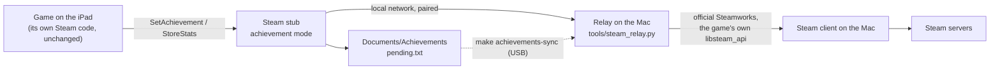

# Steam achievements from the iPad

中文: [ACHIEVEMENTS.zh-CN.md](ACHIEVEMENTS.zh-CN.md)

You play on the iPad. Your achievements reach your Steam account through the Steam client on your Mac. They arrive live while the iPad and the Mac are on the same network; otherwise they wait on the iPad and are sent later. This is optional: without it, the port behaves exactly as before (Steam is unavailable and nothing is recorded).

## How it works



- **The game's own code calls Steam.** It calls `SetAchievement` / `StoreStats` exactly as it does on the Mac. The stub only keeps the books and forwards them; it does not decide anything about achievements.
- **The Steam client on your Mac does the unlocking.** It uses the official Steamworks interface and the `libsteam_api.dylib` that came with your copy of the game. Steam itself checks that you own the game.
- **Commits go one way only.** If the game ever calls `ClearAchievement` or `ResetAllStats`, nothing is forwarded, so nothing on your Steam account is cleared.
- **Steam shows you in game.** While the iPad is connected, the relay keeps a Steam session open: Steam shows you playing Disco Elysium and counts the playtime.
- **Nothing is lost when the Mac is away.** If the Mac cannot be reached, entries wait in `pending.txt` on the iPad. They are sent when the iPad reconnects, or over a cable with `make achievements-sync`.

## What you need

- Steam for Mac, logged in with the account that owns the game. The Mac version of the game must be installed; the port needs it anyway.
- For live delivery: the iPad and the Mac on the same local network, and the Mac awake.
- An app built in achievement mode (below).

## Setting it up (once)

```
make relay-pair                 # creates the pairing secret in config.env
```

1. In `config.env`, set `ACH_RELAY="1"`.
2. Run `make stubs build install`. The app on the iPad has to be rebuilt and reinstalled with the secret. Reinstalling keeps the game data and your saves.
3. Run `make relay-install`. This sets up a background service that starts whenever you log in to the Mac. To try it first without installing, run `make relay` in a terminal, or `make relay DRY_RUN=1`, which logs what would be committed and unlocks nothing.
4. Start the game on the iPad. The first time, iPadOS asks to allow Disco Elysium to find devices on your local network. Tap **Allow**.
5. Run `make relay-status`. The log should show `iPad connected` and `Steam session started`.

## Everyday use

There is nothing to do. When you unlock an achievement in the game, it appears on Steam a few seconds later, as long as the Mac is awake and Steam is running.

## Catching up

| Situation | What to do |
|---|---|
| Achievements you earned on the iPad before turning this on | Nothing recorded them. `make achievements` lists every achievement with its state; `make achievements-unlock NAMES="ACH_KIM ACH_CUNO"` unlocks the ones you name, after asking you to confirm |
| You played away from home | The entries are sent automatically the next time the iPad reaches the Mac. Or connect the cable and run `make achievements-sync` |

## Commands

| Command | What it does | Touches your Steam account |
|---|---|---|
| `make achievements` | Lists every achievement, its state and unlock time | Read only |
| `make achievements-unlock NAMES="…"` | Unlocks the named achievements by hand (asks first) | Writes |
| `make achievements-sync` | Over USB: fetches the iPad's queue, commits it, writes Steam's state back to the iPad | Writes |
| `make relay-pair` | Creates a new pairing secret in `config.env`; rebuild and reinstall the app afterwards | — |
| `make relay` | Runs the live relay in the foreground; add `DRY_RUN=1` to unlock nothing | Writes (unless dry run) |
| `make relay-install` / `make relay-uninstall` | Installs or removes the background service | Writes |
| `make relay-status` | Shows the background service, whether Steam is running, and the recent log | — |

## What is stored where

| Where | File | Contents |
|---|---|---|
| iPad | `Documents/Achievements/pending.txt` | Entries not yet confirmed by Steam (also visible in the Files app) |
| iPad | `Documents/Achievements/state.txt` | Steam's state as of the last connection: achievements, stats, persona name, language |
| Mac | `config.env` | `ACH_RELAY`, `ACH_RELAY_HOST`, `ACH_RELAY_PORT`, `ACH_RELAY_SECRET` (never committed) |
| Mac | `~/Library/LaunchAgents/<bundle id>.steam-relay.plist` | The background service, including the secret; readable only by you |
| Mac | `~/Library/Application Support/DEPortSteamRelay/steam_relay.py` | The copy the service runs. launchd processes cannot read `~/Documents` by default |
| Mac | `~/Library/Logs/DEPortSteamRelay.log` | The service's log |

## Security and privacy

- **Pairing:** only a device that knows the pairing secret can use the relay (HMAC-SHA256 challenge). The secret is compiled into your own build of the app and stays out of git.
- **Network:** the connection stays on your local network and is not encrypted; what travels over it is achievement names and Steam's achievement state. Do not forward the port to the internet. To use it away from home, put both devices on a private VPN such as Tailscale and set `ACH_RELAY_HOST` to the Mac's address there.
- **Your Steam login:** the relay never sees your Steam password. It uses the Steam client that is already logged in on the Mac.
- **Firewall:** the relay runs with macOS's own `/usr/bin/python3`, and the macOS firewall allows Apple-signed system software by default, so no "accept incoming connections?" prompt appears.
- **Changing the secret:** run `make relay-pair`, then `make stubs build install`, then `make relay-install`.

## Limits

- **Live delivery needs the Mac.** The Mac must be awake with Steam running; otherwise entries are queued.
- **Unlock time:** Steam records when the achievement was committed, not when you earned it on the iPad.
- **The pop-up:** Steam's achievement pop-up appears on the Mac, not on the iPad.
- **No Mac play at the same time:** while a session is open, you cannot start Disco Elysium on the Mac, because Steam already counts it as running. Close the game on the iPad or stop the relay first.
- **Language:** in achievement mode the game is told the Steam language of your Mac (after the first connection). Before that, it is told the language derived from the iPad's preferred language.
- **Steam's terms:** Valve's terms do not address this setup. The achievements are earned in the game and committed by the official client, so the risk to your account should be low, but it is not zero.

## Troubleshooting

| Symptom | Check |
|---|---|
| `make relay-status`: the service is not running | Run `make relay-install` again; look at `~/Library/Logs/DEPortSteamRelay.log` |
| `Player.log`: `cannot reach the Mac at …` | Same network? Mac awake? Relay running? On the iPad: Settings → Privacy & Security → Local Network → Disco Elysium is on |
| `Player.log`: `the Mac refused the session: ERR auth` | The app and the Mac have different secrets: after `make relay-pair` rebuild and reinstall the app, then `make relay-install` |
| `Player.log`: `the Mac refused the session: ERR steam …` | Steam is not running on the Mac, or not logged in |
| Relay log: `Unknown achievement …, dropped` | The game sent a name Steam does not have; it is removed from the queue |
| An achievement did not arrive | `pending.txt` on the iPad (Files app) still lists it; the relay log shows the session |

`make logs` fetches `Player.log`; every relay line starts with `[DEPort] steam relay:`.

## Status

| | Result |
|---|---|
| Mac: `make achievements` against a real Steam account | Works (45 achievements read) |
| Mac: the iPad stub built for macOS against `make relay DRY_RUN=1` | Pairing accepted and a wrong secret rejected; Steam state received; an unknown name dropped; a real name forwarded and kept queued in dry run; callbacks 1101 / 1102 / 1103 delivered with the expected sizes |
| iPad: the game unlocking an achievement and Steam receiving it | Not verified yet |

How it is built: [PORTING_NOTES.md](PORTING_NOTES.md) section 10.
