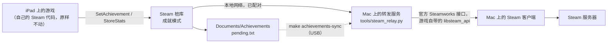

# 在 iPad 上玩，拿 Steam 成就

English: [ACHIEVEMENTS.md](ACHIEVEMENTS.md)

在 iPad 上玩，成就会通过你 Mac 上的 Steam 客户端进到你的 Steam 账号。iPad 和 Mac 在同一个网络里时实时送达；不在时先留在 iPad 上，之后补发。**实验性，默认关闭：**不开启时，移植版和原来完全一样（Steam 不可用，成就不记录）。目前只在一套环境上验证过（[DEPENDENCIES.zh-CN.md](DEPENDENCIES.zh-CN.md) 里的参考 Mac 和 iPad），遇到问题请反馈。

## 原理



- **调用 Steam 的是游戏自己的代码。**它和在 Mac 上一样调用 `SetAchievement` / `StoreStats`。桩库只负责记账和转发，不替游戏决定任何成就。
- **解锁的是你 Mac 上的 Steam 客户端。**它用官方 Steamworks 接口，以及你那份游戏自带的 `libsteam_api.dylib`。是否拥有这款游戏由 Steam 自己校验。
- **只单向提交。**游戏如果调用 `ClearAchievement` 或 `ResetAllStats`，一律不转发，你 Steam 上的成就不会被清掉。
- **Steam 会显示你在游戏中。**iPad 连着的时候，转发服务一直开着一个 Steam 会话：Steam 显示你"正在玩 Disco Elysium"，也会计入游戏时长。
- **Mac 不在也不会丢。**连不上 Mac 时，记录留在 iPad 的 `pending.txt` 里，下次连上自动补发；也可以接上线用 `make achievements-sync` 同步。

## 需要什么

- Mac 版 Steam，登录拥有这款游戏的账号。
- 运行 `make relay-install` 时 Mac 版游戏要装着：它会把游戏自带的 `libsteam_api.dylib` 留一份副本。之后可以把游戏从 Mac 上卸载，读取和提交成就照样可用（已测试）。不过重新构建 iPad 版 App 时，还是要把游戏装回来。
- 实时送达还需要：iPad 和 Mac 在同一个本地网络里，Mac 没有睡眠。
- 一个以成就模式构建的 App（见下文）。

## 设置（只做一次）

```
make relay-pair                 # 在 config.env 里生成配对密钥
```

1. 在 `config.env` 里设置 `ACH_RELAY="1"`。
2. 运行 `make stubs build install`。iPad 上的 App 要带着密钥重新构建、重新安装。重装不会丢游戏数据和存档。
3. 运行 `make relay-install`。这会装一个后台服务，以后每次登录 Mac 都会自动启动。想先试试、暂时不装的话，在终端里运行 `make relay`；或者 `make relay DRY_RUN=1`，只记下本来要提交什么，什么都不解锁。
4. 在 iPad 上启动游戏。第一次运行时，iPadOS 会问是否允许 Disco Elysium 查找本地网络上的设备，点**允许**。
5. 运行 `make relay-status`，日志里应该出现 `iPad connected` 和 `Steam session started`。

## 日常使用

什么都不用做。在游戏里解锁成就，几秒后就会出现在 Steam 上，前提是 Mac 醒着、Steam 在运行。

## 补成就

| 情况 | 怎么做 |
|---|---|
| 开启之前在 iPad 上拿到的成就 | 当时没有任何记录。`make achievements` 列出全部成就和状态；`make achievements-unlock NAMES="ACH_KIM ACH_CUNO"` 解锁你指定的那些，解锁前会请你确认 |
| 在外面玩的 | 下次 iPad 连上 Mac 时自动补发；也可以接上线运行 `make achievements-sync` |

## 命令

| 命令 | 作用 | 会不会写入你的 Steam 账号 |
|---|---|---|
| `make achievements` | 列出全部成就、状态和解锁时间 | 只读 |
| `make achievements-unlock NAMES="…"` | 手动解锁指定的成就（先确认） | 写入 |
| `make achievements-sync` | 经 USB：取回 iPad 上的待提交记录，提交到 Steam，再把 Steam 上的状态写回 iPad | 写入 |
| `make relay-pair` | 在 `config.env` 里生成新的配对密钥；之后要重新构建、安装 App | — |
| `make relay` | 在前台运行实时转发；加 `DRY_RUN=1` 则什么都不解锁 | 写入（演练模式除外） |
| `make relay-install` / `make relay-uninstall` | 安装 / 卸载后台服务 | 写入 |
| `make relay-status` | 后台服务状态、Steam 是否在运行、最近的日志 | — |

## 文件放在哪里

| 位置 | 文件 | 内容 |
|---|---|---|
| iPad | `Documents/Achievements/pending.txt` | 还没被 Steam 确认的记录（"文件"App 里也能看到） |
| iPad | `Documents/Achievements/state.txt` | 上次连接时 Steam 上的状态：成就、统计值、昵称、语言 |
| Mac | `config.env` | `ACH_RELAY`、`ACH_RELAY_HOST`、`ACH_RELAY_PORT`、`ACH_RELAY_SECRET`（不会提交） |
| Mac | `~/Library/LaunchAgents/<Bundle ID>.steam-relay.plist` | 后台服务，含密钥；只有你自己可读 |
| Mac | `~/Library/Application Support/DEPortSteamRelay/steam_relay.py` | 后台服务运行的副本。launchd 启动的进程默认读不了 `~/Documents` |
| Mac | `~/Library/Application Support/DEPortSteamRelay/libsteam_api.dylib` | 后台服务加载的游戏自带 Steam 库的副本（保留 Valve 的签名），游戏卸载后服务照样能用。不会提交 |
| Mac | `~/Library/Logs/DEPortSteamRelay.log` | 后台服务的日志 |

## 安全与隐私

- **配对：**只有知道配对密钥的设备能使用转发服务（HMAC-SHA256 质询）。密钥编进你自己构建的 App，不进 git。
- **网络：**连接只在你的本地网络里，没有加密；传的是成就名称和 Steam 上的成就状态。不要把这个端口转发到公网。想在外面也用，就让两台设备加入同一个私有 VPN（比如 Tailscale），再把 `ACH_RELAY_HOST` 设成 Mac 在其中的地址。
- **你的 Steam 登录：**转发服务从来不接触你的 Steam 密码，用的是 Mac 上已经登录的 Steam 客户端。
- **防火墙：**转发服务用 macOS 自带的 `/usr/bin/python3` 运行。macOS 防火墙默认放行 Apple 签名的系统软件，所以不会弹出"是否接受传入连接"。
- **更换密钥：**依次运行 `make relay-pair`、`make stubs build install`、`make relay-install`。

## 限制

- **实时送达需要 Mac：**Mac 要醒着、Steam 要在运行；否则记录先排队。
- **解锁时间：**Steam 记的是提交的时间，不是你在 iPad 上拿到的时间。
- **弹窗：**Steam 的成就弹窗出现在 Mac 上，不在 iPad 上。
- **不能同时在 Mac 上玩：**会话开着时，Mac 上启动不了 Disco Elysium，因为 Steam 认为它已经在运行。先关掉 iPad 上的游戏，或者停掉转发服务。
- **语言：**成就模式下，游戏收到的是你 Mac 上 Steam 的语言（第一次连上之后）。在那之前，是根据 iPad 首选语言换算出的语言。
- **Steam 条款：**Valve 的条款没有提到这种用法。成就是在游戏里拿到、由官方客户端提交的，账号风险应该很低，但不是零。

## 排查

| 现象 | 检查 |
|---|---|
| `make relay-status` 显示后台服务没有运行 | 再运行一次 `make relay-install`；看 `~/Library/Logs/DEPortSteamRelay.log` |
| `Player.log`：`cannot reach the Mac at …` | 是否在同一个网络？Mac 醒着吗？转发服务在运行吗？iPad 上：设置 → 隐私与安全性 → 本地网络 → Disco Elysium 是否打开 |
| `Player.log`：`the Mac refused the session: ERR auth` | App 和 Mac 的密钥不一致：`make relay-pair` 之后要重新构建、安装 App，再 `make relay-install` |
| `Player.log`：`the Mac refused the session: ERR steam …` | Mac 上的 Steam 没有运行，或者没有登录 |
| `ERR steam Cannot load libsteam_api.dylib (…)` | 后台服务没有这个库的副本，游戏也没有安装：在 Steam 里安装 Mac 版游戏，运行 `make relay-install`，之后可以再卸载 |
| 转发日志：`Unknown achievement …, dropped` | 游戏发来了 Steam 上没有的名字，已从队列里删除 |
| 某个成就没到 | iPad 上的 `pending.txt`（"文件"App）里还有它；转发日志里能看到会话情况 |
| `Player.log`：`INITIALIZE ACHIEVEMENTS:  NONE` | 启动时出现一次是正常的，那时 Steam 还没起来。之后应当还有一行 `STEAM`；如果没有，用 `make stubs build install` 重新构建 |

`make logs` 取回 `Player.log`，转发相关的每一行都以 `[DEPort] steam relay:` 开头。

## 现状

| | 结果 |
|---|---|
| Mac：`make achievements` 读取真实的 Steam 账号 | 可用（读到 45 个成就） |
| Mac：把 iPad 桩库编译成 macOS 版，连接 `make relay DRY_RUN=1` | 配对通过，错误密钥被拒绝；收到 Steam 状态；未知名字被丢弃；真实名字被转发，演练模式下保留在队列里；1101 / 1102 / 1103 三个回调按预期大小送达 |
| iPad：游戏自己的 `Achievements.Set` 经桩库到 Mac 再返回 | 可用。`DE_ACH_TEST` 发送一个虚构的 `ACH_DE_` 名字：桩库记下它，Mac 上的 Steam 会话回答"unknown"，iPad 随即丢弃，没有解锁任何东西。`make smoke` 16 项全部通过；游戏输出 `INITIALIZE ACHIEVEMENTS:  STEAM` |
| Mac：Mac 上没有安装游戏时的转发服务 | 可用：读到全部 45 个成就；一次提交（把一个占位统计值按原值 `StoreStats`）得到了 Steam 的确认 |
| iPad → 使用保存副本的后台服务 | 可用：Mac 端出故障期间排在 iPad 上的记录，在 `make relay-install` 之后送达、得到回复并被丢弃 |
| Mac：找不到库 | 会话进程回答 `ERR steam Cannot load libsteam_api.dylib (…)`，iPad 把它写进日志；不会崩溃 |
| iPad：在游戏里真正拿到的成就出现在你的 Steam 个人资料上 | 可用。2026-10-25 在游戏里拿到的 `ACH_HARDCORE_TASK`（"Venture into the HARDCORE"）：iPad 先记下 `recorded`，再记下 `committed to Steam`，转发服务记下 `Unlocking ACH_HARDCORE_TASK`，Steam 上显示它在那个时间解锁 |

实现细节见 [PORTING_NOTES.zh-CN.md](PORTING_NOTES.zh-CN.md) 第十节。
