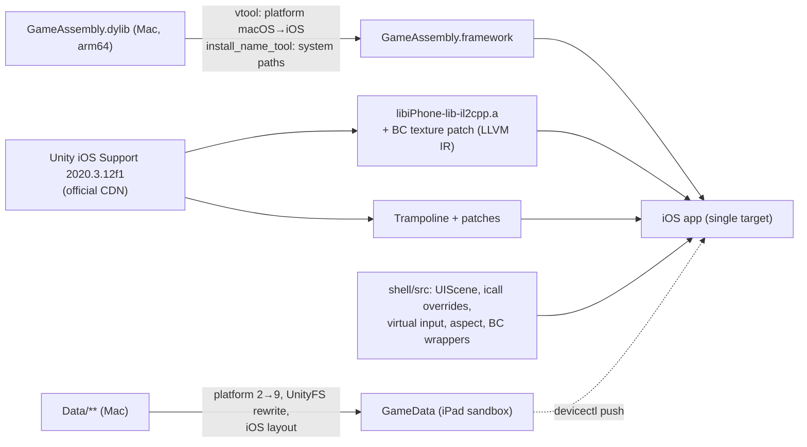

# Porting notes: how it works, every problem met, and how each was solved

中文: [PORTING_NOTES.zh-CN.md](PORTING_NOTES.zh-CN.md)

This document is the engineering record of the port. It is written so that someone (or an AI coding agent) can reproduce the result from scratch, understand why every piece exists, and adapt the approach to another build. Every symptom below was observed on a real device (iPad Pro 11-inch M5, iPadOS 27.2) and every fix was verified there.

## 1. The approach

The Mac release of Disco Elysium – The Final Cut is a Unity **2020.3.12f1** IL2CPP build:

| Mac component | Contents | Usable on iPadOS? |
|---|---|---|
| `Frameworks/GameAssembly.dylib` | All game code (C# compiled ahead of time to C++ and then to arm64) **plus** the IL2CPP runtime (`libil2cpp`) | **Yes.** Its arm64 slice imports only `libSystem`, `libc++`, `libiconv`, `libobjc`, Foundation, CoreFoundation and Security. A probe that links all 333 of its imports against the iPhoneOS SDK succeeds |
| `Frameworks/UnityPlayer.dylib` | The Unity engine for macOS | No: it links AppKit, Carbon, OpenGL |
| `Resources/Data/**` | Serialized scenes and assets, AssetBundles, Addressables, IL2CPP metadata, virtual textures | Yes, after conversion |
| `PlugIns/*` | Steam, GOG Galaxy, InControl (HID), Amplify Texture | Amplify can be retagged; the rest are replaced by stubs |

So the port **keeps the game's own compiled code** and **replaces only the engine**: the iOS player of exactly the same Unity version is downloaded from Unity's CDN (`libiPhone-lib-il2cpp.a`, linked statically), and it talks to `GameAssembly` through the public `il2cpp_*` C API. All 146 `il2cpp_*` functions that the iOS player imports are exported by the Mac `GameAssembly` (232 exports), so the two fit together with no adapter. The iOS `libil2cpp.a` is **not** linked, because `GameAssembly` already contains its own runtime.

The app is a **single target** generated with XcodeGen (`scripts/gen_project.sh`): the Trampoline sources and our `shell/src` are compiled in, `libiPhone-lib-il2cpp.a` and `baselib.a` are linked statically, and `GameAssembly` plus the plugin frameworks are embedded. Unity's usual "main app + UnityFramework.framework" split is not used; `shell/src/DEMain.mm` replaces `MainApp/main.mm`.

## 2. Build-time steps

### 2.1 Retagging Mach-O binaries (`scripts/prepare_binaries.sh`)

1. `lipo -thin arm64`, then `codesign --remove-signature`.
2. `xcrun vtool -set-build-version ios <min> <sdk> -replace`: the `LC_BUILD_VERSION` platform changes from 1 (macOS) to 2 (iOS).
3. `install_name_tool`: the install name becomes `@rpath/<Name>.framework/<Name>`; `Foundation.framework/Versions/C/Foundation`-style paths become iOS paths; AmplifyTextureNative's `OpenGL.framework` dependency becomes `@rpath/GLStub.framework/GLStub`.
4. Wrapped as a `.framework` with a minimal `Info.plist`; Xcode signs it when embedding.

The binaries use classic `LC_DYLD_INFO_ONLY` (no chained fixups), so nothing else needs changing.

### 2.2 Stubs (`scripts/build_stubs.sh`, `tools/gen_stub.py`)

`tools/gen_stub.py` reads only the *export names* of the Mac libraries and emits a C file where every function returns 0 and logs its first call. Hand-written overrides live in `shell/stubs/steam_api_overrides.c` (`SteamAPI_Init` → false, `SteamAPI_RestartAppIfNecessary` → false, `SteamAPI_IsSteamRunning` → false, and `SteamInternal_SteamAPI_Init` → 1 = failure, because 0 means success there). `GLStub` provides the 13 `gl*` functions that AmplifyTextureNative imports; they are never called under Metal.

At run time the game's `DllImport`s are redirected by `il2cpp_set_find_plugin_callback` in `shell/src/DEBootstrap.mm` (the iOS player does not set one). The same callback maps Mono's Mac CFNetwork path to the iOS one.

### 2.3 Engine registration (`tools/gen_registration.py`)

An iOS IL2CPP build normally contains editor-generated `UnityClassRegistration.cpp` / `UnityICallRegistration.cpp`. Without them nothing is registered. The generator reads `libiPhone-lib-il2cpp.a` and emits:

- `RegisterStaticallyLinkedModulesGranular()` calling all 62 `RegisterModule_*` (SharedInternals and Core first);
- `RegisterAllClasses()` → `RegisterAllClassesGranular()`;
- `RegisterAllStrippedInternalCalls()` calling **all 8163** `Register_UnityEngine_*` / `Register_UnityEngineInternal_*` / `Register_Unity_*` functions. These are **C++-mangled** (`__Z51Register_UnityEngine_AnimationCurve_Internal_Createv`); searching for plain C names finds none.

> Symptom when this was missing: `MissingMethodException: UnityEngine.AnimationCurve::Internal_Create(UnityEngine.Keyframe[])`, then abort.

At the end it calls `DERegisterICallOverrides()` (section 4), because il2cpp's icall table keeps the last registration for a name.

### 2.4 Trampoline patches (`tools/patch_trampoline.py`)

| Patch | Why |
|---|---|
| `UnityDataBundleDir()` returns our sandbox path | Data lives in `Documents/GameData`, not in the app bundle |
| `UnityUpdateMuteState(x)` becomes a no-op in `UnityAppController.mm` | The iOS player calls back `AudioSettings.Mobile.InvokeOnMuteStateChanged`, which does not exist in the Mac managed assemblies. Symptom: `Unable to find method InvokeOnMuteStateChanged…` then **SIGSEGV** in `-[UnityAppController startUnity:]` |
| `UNITY_USES_REMOTE_NOTIFICATIONS` and `UNITY_USES_IAD` set to 0 | Not needed; avoid extra entitlements |

### 2.5 Hardware BC textures (`tools/patch_player_lib.py`, `shell/src/DEMetalBC.mm`)

Every texture in the Mac build is DXT1/DXT5/BC4/BC5/BC7. Unity 2020.3's iOS player predates iPadOS BC support: `metal::PixelFormat(GraphicsFormat)` has no mapping for `GraphicsFormat` 96–109 and `metal::InitFormatUsageFlags` gives them no capability, so every such texture is **decompressed on the CPU** ("`RGBA Compressed DXT5 UNorm format is not supported, decompressing texture`": 4512 times before reaching the main menu).

M-series iPads report `MTLDevice.supportsBCTextureCompression = YES`. Probing `supportsFamily:` showed that Unity only asks for `Apple1`–`Apple9`, so faking capability queries cannot help; the format tables themselves must change.

`TextureFormatMetal.o` in the player library is native code **with embedded bitcode**. The patch tool:

1. extracts the member with `ar`, extracts `__LLVM,__bitcode` with `segedit`, and turns it into LLVM IR with `clang -S -emit-llvm`;
2. renames five functions to `de_orig_*` (`PixelFormat`, `TextureFormatBlockSize`, `PixelFormatElementSize`, `IsCompressedPixelFormat`, `UnityGraphicsFormat`) and adds `declare`s for the original names, so callers in this module call our wrappers;
3. inserts, right before the last loop of `InitFormatUsageFlags`, "if `DEMetalSupportsBC()` then set capability 3 for formats 96–109" — the same value iOS uses for ETC/ASTC — so the existing loop adds the remaining flags;
4. recompiles the IR and replaces the member in a **copy** of the library (`build/xcode/Unity/Libraries/`).

`shell/src/DEMetalBC.mm` defines the five functions again under their original C++ names: BC formats are handled there (block size 4, 8 or 16 bytes per block, sRGB handled the same way the original treats ASTC sRGB), everything else goes to `de_orig_*`. `DEMetalSupportsBC()` is true only if the GPU supports BC, a self-check confirms that `GraphicsFormat` 96–109 really are DXT1…BC7 (using Unity's own `IsCompressedFormat`, `IsSRGBFormat`, `GetBlockSize`), and `DE_DISABLE_BC` is not set. On other GPUs Unity's original behaviour is kept.

> Result: `[DEPort] BC textures: hardware (hardware=1, disabled=0, selfcheck=1)`, zero CPU decompressions, correct rendering.

### 2.6 Data conversion (`tools/convert_data.py`, `tools/unity_formats.py`)

| Problem | Fix |
|---|---|
| Every serialized file says target platform 2 (StandaloneOSX); the iOS player refuses it ("created for another build target") | Patch the 4-byte `m_TargetPlatform` in the header to 9 (iOS). Loose files are APFS clones patched in place |
| 1877 AssetBundles (UnityFS v7) contain serialized files with the same field | Decompress all blocks (LZ4/LZ4HC/LZMA), patch every serialized node, write back in 128 KiB LZ4 blocks. LZ4 comes from `libcompression` (`COMPRESSION_LZ4_RAW` is standard LZ4 block format, verified against a reference decoder) |
| Three tiny bundles became unreadable: "`Unable to read header from archive file`" (one of them was Unity's built-in shaders bundle) | LZ4 made their *block info* larger than the original (103 > 101 bytes). Store the block info uncompressed when compression does not shrink it |
| Addressables CRC | All CRCs in `catalog.json` are 0, so no CRC check happens |
| Paths the iOS player expects | `StreamingAssets/` → `Raw/`, `il2cpp_data/` → `Managed/`, plus the iOS player's own `unity default resources` |

Output layout and the reason for `Contents/Resources/Data`: see section 4.

Pushing (`scripts/device.sh push-data`): `xcrun devicectl device copy to --destination Documents/GameData` skips unchanged files (a second push takes about 1 s). **Never add `--remove-existing-content true`**: tested with Xcode 27.2, it empties the whole `Documents`, not just `GameData`, so the saves in `SaveGames`, `Logs` and `Unity` are deleted with it. The price is that files removed from the converted data stay on the iPad; when the data format changes, delete `GameData` in the Files app before pushing.

## 3. Start-up problems on the device

| Symptom | Cause | Fix |
|---|---|---|
| **SIGTRAP** at launch in `_UIApplicationEvaluateRuntimeIssueForNoSceneLifecycleAdoption` | Apps built with the iOS 27 SDK must adopt the UIScene lifecycle; Unity 2020.3 uses the old window model | `shell/src/DESceneDelegate.mm` + `UIApplicationSceneManifest`: on connect, attach the window Unity already created to the scene; forward scene foreground/background events to Unity's `application*` methods |
| Portrait UI, `UnityPortraitOnlyViewController` | The Mac build's PlayerSettings keep the iOS default orientation (portrait), overriding `Info.plist` | `shell/src/DEOrientation.mm`: before `-[UnityAppController createUI]`, call the `Screen.SetOrientationEnabled` / `Screen.RequestOrientation` icalls (landscape left/right, auto-rotation) |
| Tons of `decompressing texture` warnings and high memory | See 2.5 | — |
| `Unable to open archive file …/AssetBundles/iOS/…` | The game builds the bundle folder name from `Application.platform` | Section 4 (`platform` = OSXPlayer) |

## 4. A Mac-shaped managed environment (`shell/src/DEICallOverrides.mm`)

The game's C# was compiled for macOS, and the game also has console code paths. Letting it see `Application.platform == IPhonePlayer` sends it down unknown branches. Two icalls are overridden:

| icall | Value | Why |
|---|---|---|
| `UnityEngine.Application::get_platform` | `OSXPlayer` (1) | AssetBundle folder `OSX`, desktop branches everywhere. Native code still knows it is on iOS |
| `UnityEngine.Application::get_dataPath` | `<GameData>/Contents` | On macOS `dataPath` is `Something.app/Contents`, and the game builds paths like `dataPath + "/Resources/Data/AmplifyTexture"`. Symptom before: `DirectoryNotFoundException …/Data/Resources/Data/AmplifyTexture/….vtc` |

Therefore `GameData` mirrors a Mac bundle: `GameData/Contents/Resources/Data`, and `UnityDataBundleDir()` returns `GameData/Contents/Resources`. A symlink `Data/StreamingAssets → Raw` covers hand-built Mac-style streaming paths.

## 5. Input (`shell/src/DEVirtualInput.mm`, `DETouchOverlay.mm`)

The game is designed for a mouse: hover highlights, hover tooltips, click to walk, double-click to run. Unity's own touch-to-mouse simulation cannot hover without clicking. The port therefore **owns the `UnityEngine.Input` icalls**:

- `GetMouseButton*`, `get_mousePosition_Injected`, `get_mouseScrollDelta_Injected` come from a **frame-stepped queue**: one step per Unity frame (detected through the original `Time.frameCount` icall), so "move → press → release" always fall in different frames and hover is seen before a click.
- `touchCount` = 0, `touchSupported` = false, `mousePresent` = true, so UGUI and the game take their mouse paths.
- `GetKey*` (int and string forms), `anyKey`, `anyKeyDown` return the original value **OR** the virtual keys from the same queue. Unity iOS's native injection (`UnitySetKeyboardKeyState`) loses `GetKeyDown` when the press happens between two frames, which is why only held keys used to work.

Gestures: tap = left click, long press (+ drag) = hover only, clear drag = left drag, two-finger tap = right click, two-finger pan / trackpad scroll = wheel, pointer hover = move. Two pitfalls found with the touch trace (section 7):

1. `buttonMaskRequired = UIEventButtonMaskSecondary` is **ignored for finger touches**: the trackpad right-click recognizer stole 64 of 112 finger taps and turned them into right clicks. It must be limited with `allowedTouchTypes = @[UITouchTypeIndirectPointer]`.
2. A tap with a little movement was recognized as a drag (47 of 112). The drag recognizer must `requireGestureRecognizerToFail:` both the tap and the long press.

The game switches to a keyboard/controller mode and **ignores mouse clicks while any key is held** (it tracks `LastInputType`). The on-screen highlight (Tab) button is therefore *latched*: tapping it holds Tab until the next click in the game, which first releases Tab, then clicks. Holding the button highlights only while held. All other on-screen keys were removed because the game's own UI has those buttons.

## 6. Filling the screen (`shell/src/DEAspect.mm`)

The iPad is about 1.45:1. The game supports only fixed ratios (`AspectUtility.Ratio_16x9 / 21x9 / 16x10 / 4x3 / 9x16`) and letterboxes everything else. Three separate mechanisms had to be handled; the logic was learned by listing the classes' members through il2cpp reflection and disassembling the methods in one's own `GameAssembly` (`xcrun objdump --start-address … --stop-address …`, with the offsets printed by the diagnostics):

| Mechanism | What the game does | What the port does |
|---|---|---|
| Cameras: static `AspectUtility.wantedAspectRatio`, `SetAllCameras(ratio)`, `SetCamera()` | `SetCamera` letterboxes each camera unless `Screen.width/height` equals `wantedAspectRatio` (two decimals). `SetAllCameras(ratio)` rewrites `wantedAspectRatio` for ratios 0/1/2 only, then calls `SetCamera` on every camera | Set `wantedAspectRatio` to the screen ratio, then call `SetAllCameras(3)`, which does not rewrite it |
| UI fitters: `AspectRatioFitterUtility.registry` (a `List`), each with an `AspectRatioFitter` | The game sets their `aspectRatio` and **disables** them after one layout pass | Set `aspectRatio` to the screen ratio; for disabled fitters, enable and disable once (enabling re-runs the layout immediately) |
| HUD frame: `Global UI Fitter` under `Global UI Canvas`, script `GlobalUIFitter` | `RefreshAspect(ratio)` takes its size from a **fixed table** (16:9 → 1920×1080 …); there is no entry for 1.45:1. The bottom-right HUD buttons are anchored to it, and the start-up animation's background is its child (100 units larger at the top and bottom) | Set its `sizeDelta` to the parent canvas size (1920×1323 on this iPad) |

Everything is re-checked every 0.25 s, because the game re-applies its setting when new fitters appear or settings change. `DE_ASPECT_LETTERBOX=1` disables all of it.

> Before: black bars, HUD buttons floating ~40 pt above their decorative strip, main-menu elements showing above and below the start-up animation. After: all three full screen and aligned.

## 7. Diagnostics used during the port (all opt-in via environment variables)

Launch with `DEVICECTL_CHILD_<NAME>=…` in front of `xcrun devicectl device process launch …` (or `make run`):

| Variable | What it does | File |
|---|---|---|
| `DE_LOG_TO_CONSOLE=1` | Keep Unity's stdout on the devicectl console instead of `Documents/Logs/Player.log` | `DEBootstrap.mm` |
| `DE_SNAPSHOT_EVERY=<s>` | Save the screen every N seconds to `Documents/Logs/snap-NNN.jpg` and log the memory footprint and jetsam headroom | `DEDebugSnapshot.mm` |
| `DE_AUTOTAP="t:x,y;…"` / `DE_AUTOKEY="t:keycode;…"` | Inject clicks (normalized coordinates) and key taps at given times, so menus can be navigated without touching the device | `DEVirtualInput.mm` |
| `DE_TRACE_TOUCH=1` | Log every touch (view hit), every recognizer state, every injected press/release with its frame number | `DETouchTrace.mm`, `DEVirtualInput.mm` |
| `DE_UI_DIAG="s,s,…"` | At those times, log safe area, all cameras (rect, depth), all root canvases, every `AspectRatioFitter`, the RectTransform tree, and the methods (with offsets in `GameAssembly`) of interesting game classes | `DEUIDiag.mm` |
| `DE_CLASS_DIAG="s:frag,frag"` | At that second, list every class whose name contains a fragment: fields (static values included) and methods with their offsets in `GameAssembly`, for `objdump --start-address` | `DEClassDiag.mm` |
| `DE_ACH_TEST="s:ACH_DE_name"` | At that second, call the game's `Achievements.Set` with a made-up name (it must start with `ACH_DE_`) and report each step; Steam rejects the name, so nothing is unlocked | `DEClassDiag.mm` |
| `DE_DISABLE_BC=1`, `DE_NATIVE_TOUCH=1`, `DE_NO_OVERLAY=1`, `DE_ASPECT_LETTERBOX=1` | Turn individual fixes off for comparison | various |

Crash reports: `xcrun devicectl device info files --device <id> --domain-type systemCrashLogs`, then `device copy from` the `.ips` and read the triggered thread. `DEMetalCaps.mm` always logs the GPU name, `supportsBCTextureCompression`, and the first answer to each `supportsFamily:` / `supportsFeatureSet:` query.

## 8. Known harmless messages

- `NullReferenceException` right after `DllImport "GalaxyCSharpGlue"`: the GOG path receives null handles from the stub and gives up; the game continues.
- One `ArgumentOutOfRangeException` while settings are loaded; no visible effect.
- `SteamAPI initialization failed`: expected, Steam is stubbed. No achievements or cloud saves.

## 9. Adapting to another build

| If this changes | Expect to revisit |
|---|---|
| Unity version | Everything that touches Unity internals: `UNITY_VERSION` / changeset / SHA-256 in `config.example.env`; the anchors in `tools/patch_trampoline.py`; the IR patterns in `tools/patch_player_lib.py` (block labels such as `%114` / `%120` and the field index 52 are version-specific); the `GraphicsFormat` numbers (the self-check will refuse to enable BC); the icall names; whether `il2cpp_*` exports still cover the player's imports |
| Game build, same Unity | Class and member names in `DEAspect.mm` (`AspectUtility`, `AspectRatioFitterUtility`, `GlobalUIFitter`); the plugin names in `DEBootstrap.mm`; the assumptions about `Application.platform` / `dataPath`. Use `DE_UI_DIAG` and disassembly to re-derive them |
| Another Unity IL2CPP game with a Mac arm64 build | The engine side (sections 2–4) is generic; sections 5–6 are specific to this game's input and layout code |
| Xcode / iOS SDK | New UIKit requirements (as with UIScene); `tools/patch_player_lib.py` needs a clang that can still read the 2021 bitcode embedded in `TextureFormatMetal.o` (linking itself uses the native code of every object, there is no LTO) |

## 10. Steam achievement relay (`shell/stubs/steam_relay.c`, `tools/steam_relay.py`)

Optional, off by default (`ACH_RELAY=1` in `config.env`). User-facing guide: [ACHIEVEMENTS.md](ACHIEVEMENTS.md).

### 10.1 What the game does with Steam

- **How an unlock flows** (read from the disassembly; class and method names from `DE_CLASS_DIAG`):
  - `Achievements.Set(id)` first calls `LogWarningIfPlatformIsNone`, which calls `Achievements.get_Platform`. It then always calls `SteamAchievements.Set(id)`, and also `GOGAchievements.Set` when GOG Galaxy is signed in.
  - `get_Platform` returns STEAM when a Steam object exists and `SteamManager.Initialized` is true, and GOG when `GogGalaxyManager.get_IsUserLogged` is true; otherwise NONE.
  - `get_IsUserLogged` → `GogGalaxyManager.IsSignedIn` → `GalaxyInstance.User().SignedIn()`.
  - `SteamAchievements.Set(id)` calls `SteamUserStats.SetAchievement(id)` and `StoreStats()` when `SteamManager.Instance.m_bInitialized` is set.
  - `INITIALIZE ACHIEVEMENTS: <platform>` is logged by `Achievements.Initialize`, which runs twice: once early (before `SteamManager` exists, so `NONE`) and again from `SteamAchievements.Start`.
  - The game never calls `RequestCurrentStats` in practice.
- **The Steam backend:** it uses Steamworks.NET with manual callback dispatch. Besides the lifecycle calls (`SteamAPI_Init`, `SteamAPI_RestartAppIfNecessary`, `SteamAPI_Shutdown`, `SteamAPI_GetHSteamUser` / `GetHSteamPipe`, `SteamInternal_CreateInterface`, `SteamInternal_FindOrCreateUserInterface`), the native functions it binds are:
  - `ISteamUserStats`: `RequestCurrentStats`, `GetAchievement`, `SetAchievement`, `ClearAchievement`, `GetStatInt32` / `GetStatFloat`, `SetStatInt32` / `SetStatFloat`, `StoreStats`, `ResetAllStats`
  - `SteamAPI_ManualDispatch_*`: `Init`, `RunFrame`, `GetNextCallback`, `FreeLastCallback`, `GetAPICallResult`
  - one or two functions each from `ISteamUser` (`GetSteamID`), `ISteamFriends` (`GetPersonaName`), `ISteamApps` (`GetCurrentGameLanguage`, `GetAvailableGameLanguages`), `ISteamUtils` (`IsSteamRunningOnSteamDeck`) and `ISteamInput`
  - 23 `ISteamClient_GetISteam*` getters

  There is no ownership call such as `BIsSubscribedApp`.
- **Steam's schema:** 45 achievements (`ACH_*`), no progress-based achievements. The three stats (`stat_int`, `stat_float_aggregated`, `stat_int_incr`) look like Steamworks sample placeholders.

### 10.2 Making the game believe Steam is there

- **Interfaces:** Steamworks.NET's `CSteamAPIContext.Init` fails unless `SteamInternal_CreateInterface` and every `ISteamClient_GetISteam*` getter return non-NULL pointers. The stub returns one shared dummy object; every method ignores `self`.
- **Callbacks:** `RequestCurrentStats` queues `UserStatsReceived_t` (1101) at once, answering from the local records. `StoreStats` queues `UserStatsStored_t` (1102), plus one `UserAchievementStored_t` (1103) for each achievement newly set. `ManualDispatch_GetNextCallback` hands them out.
- **Layouts:** the macOS SDK packs callback structures to 4 bytes, and Steamworks.NET compiled for StandaloneOSX reads them that way: `CallbackMsg_t` 20 bytes, 1101 = 20, 1102 = 12, 1103 = 148. `_Static_assert`s pin these sizes.
- **Strings:** the persona name, Steam ID and languages come from the last state the Mac sent. Before the first connection, the language is derived from the iPad's preferred language (`zh-Hans` → `schinese`, …).
- **GOG Galaxy must not throw:** with the plain Galaxy stub, `GalaxyInstance.User()` returns NULL and `IsSignedIn` throws a `NullReferenceException`, so `get_Platform`, and with it every `Achievements.Set`, aborts before reaching Steam. That is harmless without achievement mode, but it would drop every achievement in it. In achievement mode `shell/stubs/galaxy_relay.c` makes `CSharp_GalaxyfApi_User___` return a placeholder object whose methods still return 0. `SignedIn()` is then false, the platform is STEAM, and the second `INITIALIZE ACHIEVEMENTS` line says `STEAM`.
- **Achievement state:** each achievement keeps two flags, `steam` (confirmed by Steam) and `local` (set on this iPad, not confirmed yet). `GetAchievement` reports either one. A queued entry is dropped once Steam confirms it, so an entry is never sent twice.

### 10.3 Delivery

- **Queue file:** `Documents/Achievements/pending.txt` holds one `<id> <A|I|F> <name> <value>` per line. It is written on every `Set…`, so nothing is lost if the app is killed.
- **Relay thread:** a background thread connects to `ACH_RELAY_HOST:ACH_RELAY_PORT` (compiled in). It retries with backoff from 5 s up to 60 s, and `StoreStats` wakes it.
- **Protocol:** text lines; the full description is at the top of the serve/worker part of `tools/steam_relay.py`.
  - The Mac sends `HELLO` with a nonce; the iPad answers `AUTH` with HMAC-SHA256 under the pairing secret.
  - The Mac replies `OK`, followed by `STATE BEGIN … STATE END`, the same format as `state.txt`.
  - Each queue entry goes out as `SET <id> …`. The Mac answers `ACK <id>` after `StoreStats` and `UserStatsStored_t` succeed, or `NAK <id> unknown`, after which the iPad drops the entry.
  - `PING` every 20 s keeps the session, and with it Steam's "playing" status, alive.
- **One Steam session per connection:** `serve` authenticates, then hands the socket to a `worker` process. The worker calls `SteamAPI_Init`, reads every achievement (and the stats named in Steam's cached `UserGameStatsSchema_<appid>.bin`), and calls `SteamAPI_Shutdown` when the iPad disconnects or has been silent for 90 s. A new authenticated connection replaces the old worker.
- **USB fallback:** `make achievements-sync` copies `pending.txt` from the iPad with `devicectl`, commits it, and copies a fresh `state.txt` back. The app reloads `state.txt` when its mtime changes, then drops the entries Steam already has.

### 10.4 Mac-side choices

- **Python:** `/usr/bin/python3` (Apple's Python 3.9) loads Valve's `libsteam_api.dylib` through `ctypes`. Because it is Apple-signed system software, the macOS firewall's default "allow built-in software" covers the listening socket. Homebrew's Python would trigger an "accept incoming connections?" prompt. `tools/steam_relay.py` therefore stays compatible with Python 3.9.
- **App ID:** `SteamAPI_Init` learns the app ID from `SteamAppId` / `SteamGameId` and from a `steam_appid.txt` in a temporary working directory.
- **Accessors:** the libsteam_api in the reference copy exports `SteamAPI_SteamUserStats_v012`, `SteamAPI_SteamUser_v021`, `SteamAPI_SteamFriends_v017` and `SteamAPI_SteamApps_v008`. A newer SDK in another build may rename them.
- **Service location:** launchd jobs cannot read `~/Documents` without a privacy grant. `make relay-install` therefore copies the script to `~/Library/Application Support/DEPortSteamRelay/`, and puts the configuration in the job's environment (plist mode 0600).

### 10.5 Verified so far

- **Mac, read-only:** `make achievements` against a real account (45 achievements).
- **Mac, loopback:** the stub compiled for macOS with a small harness against `make relay DRY_RUN=1`.
  - A wrong secret was rejected and the right one accepted.
  - State arrived with the account's real unlock states, and `GetAchievement` reported an unlocked one as achieved.
  - A queued achievement that was already unlocked on Steam was pruned before sending.
  - An unknown name was answered with `NAK … unknown` and dropped.
  - A real name was forwarded and stayed queued, because a dry run sends no `ACK`.
  - Callbacks 1101, 1102 and 1103 arrived with sizes 20, 12 and 148.
- **iPad, with `make relay DRY_RUN=1`:**
  - The game logs `INITIALIZE ACHIEVEMENTS:  STEAM` and `make smoke` passes all 16 checks.
  - `DE_ACH_TEST="40:ACH_DE_RELAY_TEST"` calls the game's own `Achievements.Set`, which returns true. The stub records the entry, the Mac answers `NAK … unknown` (Steam has no such name), and the iPad drops it. Nothing was unlocked.
  - The game's language setting (Chinese) was unchanged.
- **Not verified yet:** a real achievement earned in play reaching Steam with the relay running for real.
