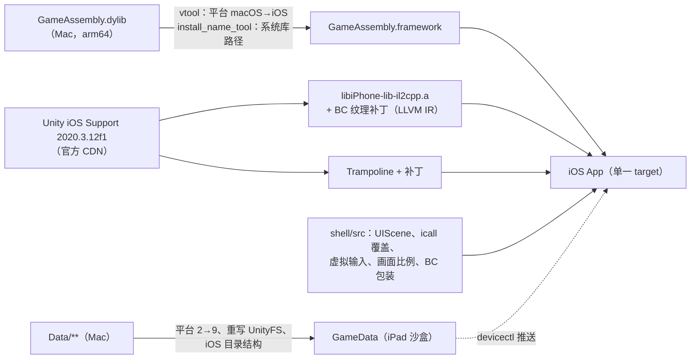

# 移植笔记：原理、遇到的每个问题、以及各自的解决办法

English: [PORTING_NOTES.md](PORTING_NOTES.md)

这份文档是这次移植的工程记录。目标是让别人（或者一个 AI 编程 agent）能够从零复刻出同样的结果，理解每个部件为什么存在，并能把这套方法用到其他构建上。下面每个现象都是在真机上观察到的（iPad Pro 11 英寸 M5，iPadOS 27.2），每个修法也都在真机上验证过。

## 一、总体思路

《极乐迪斯科：最终剪辑版》的 Mac 版是 Unity **2020.3.12f1** 的 IL2CPP 构建：

| Mac 版组件 | 内容 | 能在 iPadOS 上用吗 |
|---|---|---|
| `Frameworks/GameAssembly.dylib` | 全部游戏代码（C# 预先编译成 C++，再编译成 arm64），**以及** IL2CPP 运行时（`libil2cpp`） | **能。**它的 arm64 部分只导入 `libSystem`、`libc++`、`libiconv`、`libobjc`、Foundation、CoreFoundation 和 Security。把它全部 333 个导入符号拿 iPhoneOS SDK 做链接测试，全部通过 |
| `Frameworks/UnityPlayer.dylib` | macOS 版 Unity 引擎 | 不能：依赖 AppKit、Carbon、OpenGL |
| `Resources/Data/**` | 序列化的场景与资源、AssetBundle、Addressables、IL2CPP 元数据、虚拟纹理 | 转换后能用 |
| `PlugIns/*` | Steam、GOG Galaxy、InControl（HID 手柄）、Amplify Texture | Amplify 可以改标；其余用桩库代替 |

所以这个移植**保留游戏自己编译好的代码**，**只替换引擎**：从 Unity 的 CDN 下载完全相同版本的 iOS 播放器（`libiPhone-lib-il2cpp.a`，静态链接），它通过公开的 `il2cpp_*` C 接口与 `GameAssembly` 通信。iOS 播放器导入的 146 个 `il2cpp_*` 函数，Mac 版 `GameAssembly` 全部导出了（共 232 个导出），两者不需要任何适配层就能对接。iOS 包里的 `libil2cpp.a` **不链接**，因为 `GameAssembly` 自带运行时。

App 是用 XcodeGen 生成的**单一 target**（`scripts/gen_project.sh`）：编进 Trampoline 源码和我们的 `shell/src`，静态链接 `libiPhone-lib-il2cpp.a` 和 `baselib.a`，嵌入 `GameAssembly` 和各插件 framework。不使用 Unity 惯用的"主程序 + UnityFramework.framework"结构；`shell/src/DEMain.mm` 代替 `MainApp/main.mm`。

## 二、构建阶段

### 2.1 Mach-O 改标（`scripts/prepare_binaries.sh`）

1. `lipo -thin arm64`，再 `codesign --remove-signature`。
2. `xcrun vtool -set-build-version ios <最低版本> <SDK> -replace`：`LC_BUILD_VERSION` 的平台从 1（macOS）改为 2（iOS）。
3. `install_name_tool`：install name 改为 `@rpath/<名称>.framework/<名称>`；`Foundation.framework/Versions/C/Foundation` 这类路径改成 iOS 的路径；AmplifyTextureNative 对 `OpenGL.framework` 的依赖改为 `@rpath/GLStub.framework/GLStub`。
4. 包成带最小 `Info.plist` 的 `.framework`，嵌入时由 Xcode 签名。

这些二进制用的是传统的 `LC_DYLD_INFO_ONLY`（没有 chained fixups），其余都不需要改。

### 2.2 桩库（`scripts/build_stubs.sh`、`tools/gen_stub.py`）

`tools/gen_stub.py` 只读取 Mac 版库的*导出函数名*，生成一个 C 文件：每个函数都返回 0，并在第一次被调用时记一条日志。手写的覆盖放在 `shell/stubs/steam_api_overrides.c`（`SteamAPI_Init` → false，`SteamAPI_RestartAppIfNecessary` → false，`SteamInternal_SteamAPI_Init` → 1 表示失败，因为它用 0 表示成功）。`GLStub` 提供 AmplifyTextureNative 导入的 13 个 `gl*` 函数，在 Metal 下永远不会被调用。

运行时，游戏的 `DllImport` 由 `shell/src/DEBootstrap.mm` 里的 `il2cpp_set_find_plugin_callback` 重定向（iOS 播放器自己不设这个回调）。同一个回调也把 Mono 使用的 Mac 版 CFNetwork 路径换成 iOS 的路径。

### 2.3 引擎注册（`tools/gen_registration.py`）

正常的 iOS IL2CPP 构建里有编辑器生成的 `UnityClassRegistration.cpp` / `UnityICallRegistration.cpp`。没有它们就什么都没注册。生成器读取 `libiPhone-lib-il2cpp.a`，生成：

- `RegisterStaticallyLinkedModulesGranular()`：调用全部 62 个 `RegisterModule_*`（SharedInternals 和 Core 在前）；
- `RegisterAllClasses()` → `RegisterAllClassesGranular()`；
- `RegisterAllStrippedInternalCalls()`：调用**全部 8163 个** `Register_UnityEngine_*` / `Register_UnityEngineInternal_*` / `Register_Unity_*`。它们是 **C++ 修饰名**（`__Z51Register_UnityEngine_AnimationCurve_Internal_Createv`），按 C 符号名去找一个都找不到。

> 缺少它们时的现象：`MissingMethodException: UnityEngine.AnimationCurve::Internal_Create(UnityEngine.Keyframe[])`，随后 abort。

最后调用 `DERegisterICallOverrides()`（第四节），因为 il2cpp 的 icall 表对同一个名字只保留最后一次注册。

### 2.4 Trampoline 补丁（`tools/patch_trampoline.py`）

| 补丁 | 原因 |
|---|---|
| `UnityDataBundleDir()` 返回我们的沙盒路径 | 数据放在 `Documents/GameData`，而不是 App 包里 |
| 在 `UnityAppController.mm` 里把 `UnityUpdateMuteState(x)` 变成空操作 | iOS 播放器会回调 `AudioSettings.Mobile.InvokeOnMuteStateChanged`，而 Mac 版托管程序集里没有这个方法。现象：`Unable to find method InvokeOnMuteStateChanged…`，随后在 `-[UnityAppController startUnity:]` 里 **SIGSEGV** |
| `UNITY_USES_REMOTE_NOTIFICATIONS`、`UNITY_USES_IAD` 设为 0 | 用不到，避免额外的权限 |

### 2.5 硬件 BC 纹理（`tools/patch_player_lib.py`、`shell/src/DEMetalBC.mm`）

Mac 版的纹理全部是 DXT1/DXT5/BC4/BC5/BC7。Unity 2020.3 的 iOS 播放器写于 iPadOS 支持 BC 之前：`metal::PixelFormat(GraphicsFormat)` 没有 `GraphicsFormat` 96–109 的映射，`metal::InitFormatUsageFlags` 也不给它们任何能力，于是每张这样的纹理都**在 CPU 上解压**（"`RGBA Compressed DXT5 UNorm format is not supported, decompressing texture`"，到主菜单之前就有 4512 次）。

M 系列 iPad 报告 `MTLDevice.supportsBCTextureCompression = YES`。探测 `supportsFamily:` 发现 Unity 只查询 `Apple1`–`Apple9`，所以伪造能力查询没有用，必须改格式表本身。

播放器库里的 `TextureFormatMetal.o` 是**带嵌入 bitcode 的原生代码**。补丁工具：

1. 用 `ar` 取出这个成员，用 `segedit` 取出 `__LLVM,__bitcode`，用 `clang -S -emit-llvm` 转成 LLVM IR；
2. 把五个函数改名为 `de_orig_*`（`PixelFormat`、`TextureFormatBlockSize`、`PixelFormatElementSize`、`IsCompressedPixelFormat`、`UnityGraphicsFormat`），并为原名添加 `declare`，这样本模块里的调用方会调用我们的包装函数；
3. 在 `InitFormatUsageFlags` 的最后一个循环之前插入"如果 `DEMetalSupportsBC()` 为真，就把 96–109 的能力设为 3"（与 iOS 给 ETC/ASTC 的值相同），由原有的循环补齐其余标志；
4. 重新编译 IR，并替换播放器库**副本**里的这个成员（`build/xcode/Unity/Libraries/`）。

`shell/src/DEMetalBC.mm` 按原来的 C++ 修饰名重新定义这五个函数：BC 格式在这里处理（块宽 4，每块 8 或 16 字节，sRGB 的处理方式与原函数对 ASTC sRGB 的处理一致），其余格式转交 `de_orig_*`。只有在 GPU 支持 BC、自检确认 `GraphicsFormat` 96–109 确实是 DXT1…BC7（用 Unity 自己的 `IsCompressedFormat`、`IsSRGBFormat`、`GetBlockSize` 判断）、且没有设置 `DE_DISABLE_BC` 时，`DEMetalSupportsBC()` 才为真。其他 GPU 上保持 Unity 原来的行为。

> 结果：`[DEPort] BC textures: hardware (hardware=1, disabled=0, selfcheck=1)`，CPU 解压次数为 0，画面正确。

### 2.6 数据转换（`tools/convert_data.py`、`tools/unity_formats.py`）

| 问题 | 修法 |
|---|---|
| 每个序列化文件都写着目标平台 2（StandaloneOSX），iOS 播放器拒绝加载（"created for another build target"） | 把文件头里 4 字节的 `m_TargetPlatform` 改成 9（iOS）。独立文件先做 APFS 克隆，再原地修改 |
| 1877 个 AssetBundle（UnityFS v7）里的序列化文件也有同样的字段 | 解压全部数据块（LZ4/LZ4HC/LZMA），修改每个序列化节点，再按 128 KiB 一块用 LZ4 写回。LZ4 来自 `libcompression`（`COMPRESSION_LZ4_RAW` 就是标准 LZ4 块格式，已用参考解码器验证） |
| 三个很小的包无法读取："`Unable to read header from archive file`"（其中一个是 Unity 内置着色器包） | LZ4 把它们的*块信息*压得比原来还大（103 > 101 字节）。压缩后不变小时，块信息改为不压缩存放 |
| Addressables 的 CRC | `catalog.json` 里所有 CRC 都是 0，不会做 CRC 校验 |
| iOS 播放器期望的路径 | `StreamingAssets/` → `Raw/`，`il2cpp_data/` → `Managed/`，并换上 iOS 播放器自己的 `unity default resources` |

输出的目录结构，以及为什么是 `Contents/Resources/Data`，见第四节。

## 三、设备上的启动问题

| 现象 | 原因 | 修法 |
|---|---|---|
| 启动即 **SIGTRAP**，位于 `_UIApplicationEvaluateRuntimeIssueForNoSceneLifecycleAdoption` | 用 iOS 27 SDK 构建的 App 必须采用 UIScene 生命周期；Unity 2020.3 还是旧的窗口模型 | `shell/src/DESceneDelegate.mm` + `UIApplicationSceneManifest`：场景连接时把 Unity 已创建的窗口挂到场景上，并把场景的前后台事件转发给 Unity 的 `application*` 方法 |
| 竖屏界面，`UnityPortraitOnlyViewController` | Mac 版 PlayerSettings 里的 iOS 方向保持默认值（竖屏），盖过了 `Info.plist` | `shell/src/DEOrientation.mm`：在 `-[UnityAppController createUI]` 之前调用 `Screen.SetOrientationEnabled` / `Screen.RequestOrientation` 两个 icall（左右横屏、自动旋转） |
| 大量 `decompressing texture` 警告、内存占用高 | 见 2.5 | — |
| `Unable to open archive file …/AssetBundles/iOS/…` | 游戏按 `Application.platform` 拼 AssetBundle 目录名 | 第四节（platform = OSXPlayer） |

## 四、与 Mac 一致的托管环境（`shell/src/DEICallOverrides.mm`）

游戏的 C# 是为 macOS 编译的，而且游戏里还有主机平台的代码分支。让它看到 `Application.platform == IPhonePlayer`，会走进未知的分支。所以覆盖了两个 icall：

| icall | 值 | 原因 |
|---|---|---|
| `UnityEngine.Application::get_platform` | `OSXPlayer`（1） | AssetBundle 目录用 `OSX`，各处都走桌面分支。原生层仍然知道自己在 iOS 上 |
| `UnityEngine.Application::get_dataPath` | `<GameData>/Contents` | macOS 上的 `dataPath` 是 `某某.app/Contents`，游戏会拼出 `dataPath + "/Resources/Data/AmplifyTexture"` 这样的路径。修复前的现象：`DirectoryNotFoundException …/Data/Resources/Data/AmplifyTexture/….vtc` |

因此 `GameData` 模仿 Mac 的 .app 结构：`GameData/Contents/Resources/Data`，`UnityDataBundleDir()` 返回 `GameData/Contents/Resources`。另有一个符号链接 `Data/StreamingAssets → Raw`，兼容按 Mac 规则手工拼出的流式资源路径。

## 五、输入（`shell/src/DEVirtualInput.mm`、`DETouchOverlay.mm`）

这个游戏是为鼠标设计的：悬停高亮、悬停看说明、单击行走、双击跑步。Unity 自带的"触摸模拟鼠标"做不到只悬停不点击。所以移植**接管了 `UnityEngine.Input` 的 icall**：

- `GetMouseButton*`、`get_mousePosition_Injected`、`get_mouseScrollDelta_Injected` 由一个**逐帧推进的队列**提供：每个 Unity 帧推进一步（用原来的 `Time.frameCount` icall 判断换帧），因此"移动 → 按下 → 松开"一定落在不同的帧里，游戏会先看到悬停再看到点击。
- `touchCount` = 0、`touchSupported` = false、`mousePresent` = true，让 UGUI 和游戏都走鼠标路径。
- `GetKey*`（整数和字符串两种形式）、`anyKey`、`anyKeyDown` 返回原值与同一队列里虚拟按键的**并集**。iOS 版 Unity 的原生注入（`UnitySetKeyboardKeyState`）在两帧之间按下时会丢掉 `GetKeyDown`，这就是之前只有按住型的键有效的原因。

手势：轻点 = 左键单击，长按（+拖动）= 只悬停，明显拖动 = 按住左键拖动，双指轻点 = 右键，双指滑动 / 触控板滚动 = 滚轮，指针悬停 = 移动光标。用触摸追踪（第七节）找到了两个坑：

1. `buttonMaskRequired = UIEventButtonMaskSecondary` **对手指触摸不起作用**：给触控板准备的右键识别器抢走了 112 次手指轻点中的 64 次，把它们变成了右键。必须用 `allowedTouchTypes = @[UITouchTypeIndirectPointer]` 加以限定。
2. 带一点位移的轻点被识别成了拖动（112 次里有 47 次）。拖动识别器必须对轻点和长按都 `requireGestureRecognizerToFail:`。

游戏会切到键盘/手柄模式，**在有按键按住时忽略鼠标点击**（它记录了 `LastInputType`）。所以屏幕上的高亮（Tab）按钮是*锁定式*的：点一下就一直按住 Tab，直到下一次在游戏里点击——点击前会先松开 Tab 再点。按住按钮不放则只在按住期间高亮。其他屏幕按键都去掉了，因为游戏界面里本来就有这些按钮。

## 六、铺满屏幕（`shell/src/DEAspect.mm`）

iPad 约为 1.45:1。游戏只支持固定比例（`AspectUtility.Ratio_16x9 / 21x9 / 16x10 / 4x3 / 9x16`），其他比例一律加黑边。需要分别处理三套机制；它们的逻辑是通过 il2cpp 反射列出类成员、再在自己的 `GameAssembly` 里反汇编对应方法得出的（`xcrun objdump --start-address … --stop-address …`，偏移由诊断工具打印）：

| 机制 | 游戏的做法 | 移植的做法 |
|---|---|---|
| 相机：静态字段 `AspectUtility.wantedAspectRatio`、`SetAllCameras(ratio)`、`SetCamera()` | `SetCamera` 给每个相机加黑边，除非 `Screen.width/height` 与 `wantedAspectRatio` 相等（精确到两位小数）。`SetAllCameras(ratio)` 只在比例为 0/1/2 时改写 `wantedAspectRatio`，然后对每个相机调用 `SetCamera` | 把 `wantedAspectRatio` 设为屏幕比例，再调用 `SetAllCameras(3)`，它不会改写这个值 |
| UI 适配器：`AspectRatioFitterUtility.registry`（一个 `List`），每个实例带一个 `AspectRatioFitter` | 游戏设置它们的 `aspectRatio`，算完一次布局后就把它们**禁用** | 把 `aspectRatio` 设为屏幕比例；对禁用的适配器启用再禁用一次（启用时会立即重算布局） |
| HUD 框：`Global UI Canvas` 下的 `Global UI Fitter`，脚本 `GlobalUIFitter` | `RefreshAspect(ratio)` 从一张**固定表**里取尺寸（16:9 → 1920×1080 …），没有 1.45:1 这一项。右下角 HUD 按钮锚定在它上面，启动动画的背景是它的子节点（上下各多出 100 个单位） | 把它的 `sizeDelta` 设为父 Canvas 的尺寸（这台 iPad 上是 1920×1323） |

以上每 0.25 秒检查一次，因为出现新的适配器或改了设置时，游戏会重新套用它的比例设置。`DE_ASPECT_LETTERBOX=1` 关闭全部这些处理。

> 修复前：有黑边，HUD 按钮浮在它的装饰条上方约 40 点，启动动画上下露出主菜单。修复后：三者都铺满屏幕并对齐。

## 七、移植中用到的诊断手段（全部通过环境变量开启）

在 `xcrun devicectl device process launch …`（或 `make run`）前面加上 `DEVICECTL_CHILD_<名字>=…`：

| 变量 | 作用 | 文件 |
|---|---|---|
| `DE_LOG_TO_CONSOLE=1` | Unity 的标准输出留在 devicectl 控制台，而不是写进 `Documents/Logs/Player.log` | `DEBootstrap.mm` |
| `DE_SNAPSHOT_EVERY=<秒>` | 每隔 N 秒把画面存到 `Documents/Logs/snap-NNN.jpg`，并记录内存占用和距系统强制结束的余量 | `DEDebugSnapshot.mm` |
| `DE_AUTOTAP="秒:x,y;…"` / `DE_AUTOKEY="秒:键码;…"` | 在指定时间注入点击（归一化坐标）和按键，不碰设备也能走菜单 | `DEVirtualInput.mm` |
| `DE_TRACE_TOUCH=1` | 记录每次触摸（命中的视图）、每个识别器的状态、每次注入的按下/松开及其帧号 | `DETouchTrace.mm`、`DEVirtualInput.mm` |
| `DE_UI_DIAG="秒,秒,…"` | 在这些时间点记录安全区、所有相机（视口、深度）、所有根 Canvas、每个 `AspectRatioFitter`、RectTransform 层级，以及关心的游戏类的方法（含在 `GameAssembly` 中的偏移） | `DEUIDiag.mm` |
| `DE_DISABLE_BC=1`、`DE_NATIVE_TOUCH=1`、`DE_NO_OVERLAY=1`、`DE_ASPECT_LETTERBOX=1` | 单独关闭某项修复，便于对比 | 各处 |

崩溃报告：`xcrun devicectl device info files --device <id> --domain-type systemCrashLogs`，再用 `device copy from` 取回 `.ips`，看触发崩溃的线程。`DEMetalCaps.mm` 总会记录 GPU 名称、`supportsBCTextureCompression`，以及每种 `supportsFamily:` / `supportsFeatureSet:` 查询的第一次结果。

## 八、已知无害的日志

- `DllImport "GalaxyCSharpGlue"` 之后的 `NullReferenceException`：GOG 路径从桩库拿到空句柄后放弃，游戏继续运行。
- 加载设置时的一次 `ArgumentOutOfRangeException`：没有可见影响。
- `SteamAPI initialization failed`：预期之内，Steam 是桩库。没有成就和云存档。

## 九、适配其他构建

| 如果变的是 | 预计要重新检查 |
|---|---|
| Unity 版本 | 一切涉及 Unity 内部的地方：`config.example.env` 里的 `UNITY_VERSION` / changeset / SHA-256；`tools/patch_trampoline.py` 的锚点；`tools/patch_player_lib.py` 的 IR 模式（`%114` / `%120` 这类基本块标签和字段编号 52 都与版本相关）；`GraphicsFormat` 的数值（自检会拒绝启用 BC）；icall 名称；`il2cpp_*` 导出是否仍覆盖播放器的导入 |
| 游戏构建（Unity 版本不变） | `DEAspect.mm` 里的类名和成员名（`AspectUtility`、`AspectRatioFitterUtility`、`GlobalUIFitter`）；`DEBootstrap.mm` 里的插件名；关于 `Application.platform` / `dataPath` 的假设。用 `DE_UI_DIAG` 和反汇编重新推导 |
| 另一个有 Mac arm64 构建的 Unity IL2CPP 游戏 | 引擎这一侧（第二到第四节）是通用的；第五、六节是针对这个游戏的输入和布局代码的 |
| Xcode / iOS SDK | 新的 UIKit 要求（就像 UIScene 这次）；LTO 链接 bitcode 播放器库需要仍能读取它的 LLVM |
